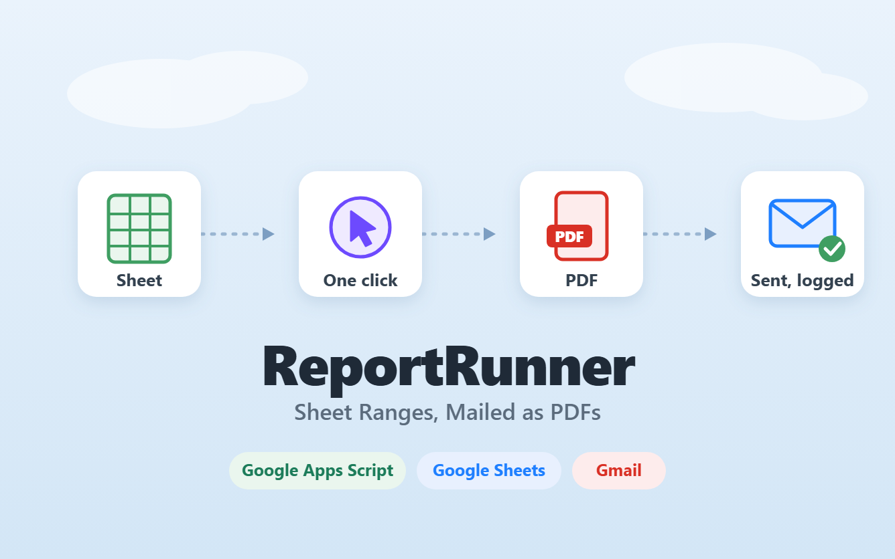
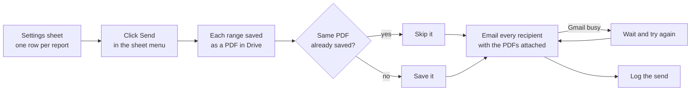

# ReportRunner

**A small Google Sheets add-on that turns chosen parts of a spreadsheet into clean PDF reports and emails them to a list of people with one click.**

It will not save the same PDF twice, it tries again when Gmail is busy, and it keeps a record of every send. This page shows what it does and what changed. The script itself is not published. If you want one for your team, see [Want a system like this?](#want-a-system-like-this)

---

## The problem

Sending the same reports every week, by hand. It is the kind of job every operations team has, it eats hours, and it is one of the easiest things to get wrong.

Open each tab, export it to PDF, save it to Drive with the right name, write an email, attach all the PDFs, type the same message, and send it to each person one at a time. Then hope nothing was missed.

## What I built

One settings sheet says what gets exported, which way round the page goes, who receives it, and what the email says. Then one click does the rest.

| Step | What happens |
|---|---|
| **1. Set up** | List the tabs, cell ranges, recipients, subject and message in one place. Changing a report means editing a row, not code. |
| **2. Click Send** | One click from a menu inside the spreadsheet. No code, no setup window. |
| **3. Make the PDFs** | Each range becomes a PDF, saved in its own Drive folder so reports never get lost. |
| **4. Send to everyone** | Each person gets the email with all the PDFs attached, from a sender name you choose. |
| **5. Log everything** | Time, PDF name, link, recipient and status are all recorded automatically. |

## How it fits together

## The result

| | |
|---|---|
| **1 click** | replaces a multi-tab, multi-export, multi-attach routine |
| **Any number** | of reports and recipients: add a row and it scales with you |
| **0** | duplicate PDFs saved |
| **100%** | of sends logged with time, link, recipient and status |

A 90-second demo of the full cycle is on the [case study page](https://emayourvirtualassistant.com/projects/ReportRunner/index.html).

## What it is built with

Google Apps Script, Google Sheets, Google Drive and Gmail. No outside services and no subscriptions: it runs entirely on the Google account the team already has.

**AI:** no AI runs in this automation. The same data always produces the same report.

## My role

**Sole automation engineer:** architecture, build and testing.

---

## What is in this repository

This is a showcase, not a download. The script and setup that run ReportRunner are not published.

## Want a system like this?

If someone on your team sends the same reports every week by hand, this can take that over. Tell me which reports go out, to whom and how often, and I will tell you what it would take.

- **Full case study**, with the demo video:
  [emayourvirtualassistant.com/projects/ReportRunner](https://emayourvirtualassistant.com/projects/ReportRunner/index.html)
- **Get in touch:** [emayourvirtualassistant.com/#contact](https://emayourvirtualassistant.com/#contact)
- **LinkedIn:** [linkedin.com/in/emayourva](https://www.linkedin.com/in/emayourva/)

Built by **[Ema](https://emayourvirtualassistant.com)**, automation and data operations.
Open to automation projects, contract work, and full-time roles.

---

© 2026 Ema Your VA. All rights reserved. This repository is a portfolio showcase. See [LICENSE](LICENSE).
